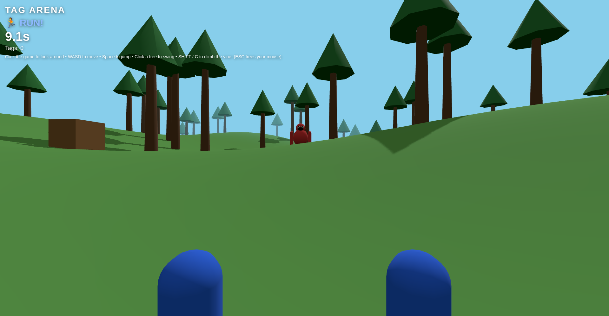
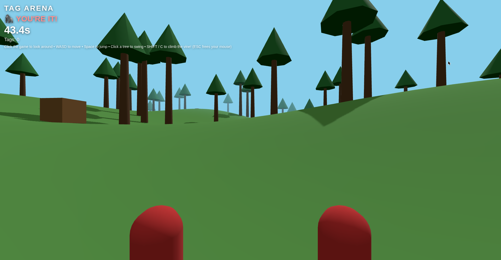

# Tag Arena

First-person gorilla tag with hills and vine swinging. You ARE the gorilla — no legs, all arms, giant forest, rolling hills.

## Play it

[Live demo](https://tag-arena.vercel.app)

## How to play

- **Click the game** to capture your mouse and look around (ESC frees it)
- **WASD / arrows** to run
- **Space** to jump — sprint up a hill and jump at the top for big air
- **Click a tree** to grab a vine and swing
- **SHIFT / C** to climb up / slide down the vine
- **Red means you're it.** Tag the other gorilla to pass it on — but you can't be tagged while airborne!

## Screenshots




## Run it locally

```
npm install
npm run dev
```

## Built with

- [Three.js](https://threejs.org/) — 3D rendering
- [Vite](https://vitejs.dev/) — dev server and build
- Vanilla JavaScript, no game engine
